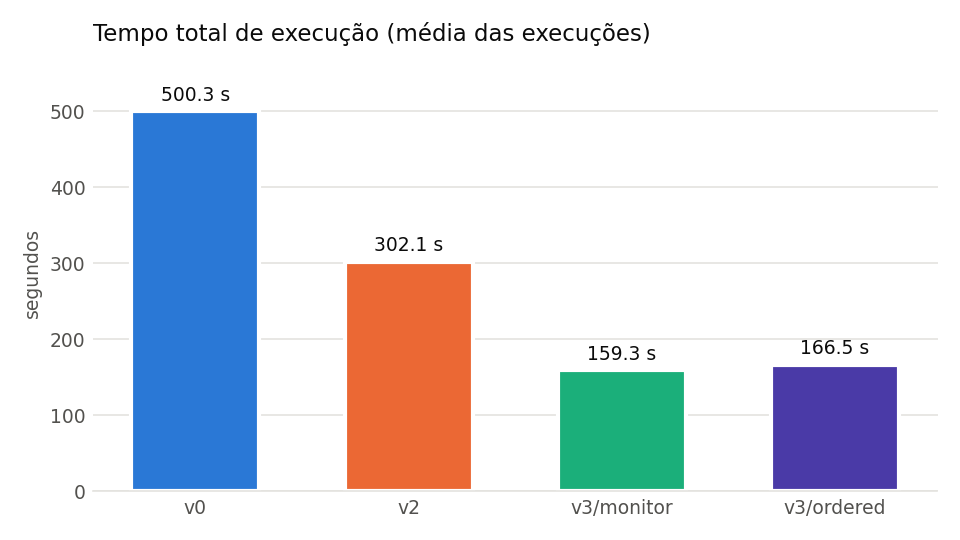
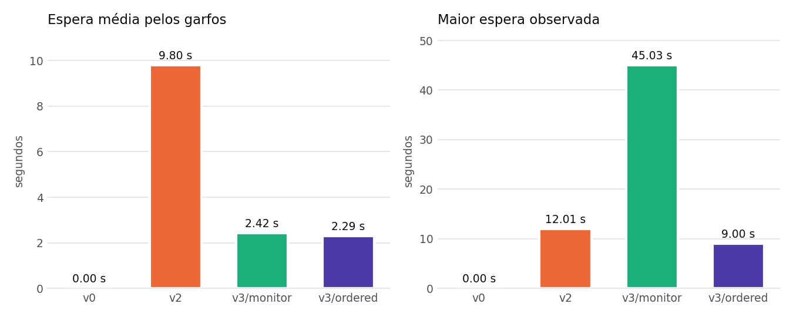
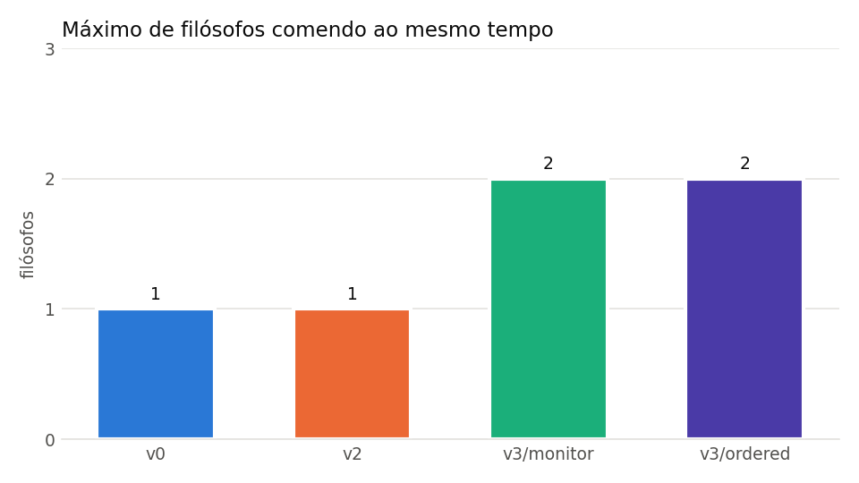

# Trabalho 1 — Concorrência e Sincronização: o Problema dos Filósofos Jantando

**Fundamentos de Processamento Paralelo e Distribuído — PUCRS**

**Grupo:** TODO (nome 1), TODO (nome 2), TODO (nome 3)
**Repositório:** https://github.com/enricolazzari/t1-FPPD

---

## 1. Soluções implementadas e mecanismos de sincronização

Todas as versões usam 5 filósofos, 20 ciclos por filósofo (pensar → adquirir garfos → comer → liberar garfos), 2 s pensando e 3 s comendo.

**V0 — Sequencial.** <!-- confirmar com o autor -->
Os filósofos executam um após o outro, sem goroutines. Não há disputa por garfos, então não há mecanismo de sincronização. O tempo total é o limite inferior de concorrência (1 comendo por vez): 5 × 20 × (2 + 3) s = 500 s.

**V1 — Concorrente sujeita a deadlock.** <!-- confirmar com o autor -->
Uma goroutine por filósofo e garfos como `[5]sync.Mutex`. Cada um trava o garfo esquerdo e depois o direito. Uma goroutine `vigia()` encerra o programa se não houver progresso em 10 s.

**V2 — Sem deadlock, com sincronização excessiva.** <!-- confirmar com o autor -->
Igual à V1, com um semáforo (canal com buffer 4) que o filósofo precisa adquirir antes de pegar os garfos e solta depois de devolvê-los. No máximo 4 disputam garfos ao mesmo tempo.

**V3 — Concorrente aprimorada (monitor com estados).**
Cada filósofo tem um estado (PENSANDO, FAMINTO, COMENDO), protegido por um `sync.Mutex` do monitor, e uma variável de condição `sync.Cond` própria.
- `pegarGarfos(i)` marca FAMINTO e chama `testar(i)`, que só passa *i* para COMENDO se nenhum vizinho estiver comendo. Caso contrário, o filósofo dorme em `cond[i].Wait()`.
- `soltarGarfos(i)` marca PENSANDO e chama `testar` nos dois vizinhos, acordando quem puder comer.
- Os dois garfos são obtidos atomicamente: nenhum filósofo segura um garfo enquanto espera o outro.

Como variante (`-strategy=ordered`), a V3 também implementa ordenação de recursos: cada filósofo trava primeiro o garfo de menor índice.

### Análise comparativa

| | Mecanismo | Condição de Coffman quebrada | Concorrência máxima possível |
|---|---|---|---|
| V0 | nenhum (sequencial) | — (não há concorrência) | 1 |
| V1 | `sync.Mutex` por garfo | nenhuma → deadlock | 2, se não travar |
| V2 | mutex por garfo + semáforo (canal buffer 4) | espera circular | 2 em teoria; 1 observado |
| V3 monitor | `sync.Mutex` + `sync.Cond` por filósofo | posse-e-espera | 2 |
| V3 ordered | mutex por garfo, aquisição ordenada | espera circular | 2 |

A V2 e a V3 são ambas corretas. A diferença está em **qual** condição cada uma quebra.
- A V2 ainda permite que um filósofo segure o garfo esquerdo enquanto espera o direito. Com tempos iguais, os quatro admitidos pegam o esquerdo ao mesmo tempo e formam uma corrente de espera em que só o último come.
- A V3 elimina a posse-e-espera, e não-vizinhos comem em paralelo.

---

## 2. Resultados

### Tabela comparativa

<!-- gerada por scripts/report.py a partir de results/todas.csv -->
TABELA

### Gráficos







### Capturas de tela

- `prints/v0.png` — TODO execução da V0
- `prints/v1_deadlock.png` — TODO print da V1 travada (texto completo em `results/v1_deadlock.txt`)
- `prints/v2.png` — TODO execução da V2
- `prints/v3_monitor.png` — TODO `./build/v3 -v` mostrando dois filósofos comendo juntos
- `prints/v3_ordered.png` — TODO

### Evidência do deadlock da V1

Saída de `results/v1_deadlock.txt`:

```
[P1] [P2] [P3] [P4] [P5]

                     T1
 T1
      T1
           T1
                T1
                L1
           L1
      L1
 L1
                     L1

DEADLOCK detected! No progress in the last 10s
Cycles per philosopher: [0 0 0 0 0]
```

Os cinco filósofos pensaram (T1) e pegaram o garfo esquerdo (L1). Nenhum chegou a comer (E1), e o `vigia()` detectou 10 s sem progresso.
- **Recursos de cada filósofo:** P*i* segura o garfo *i*.
- **Recurso esperado:** P*i* espera o garfo (*i*+1) mod 5.
- **Espera circular:** P0 → P1 → P2 → P3 → P4 → P0. Cada um espera o garfo que o próximo segura.
- **Condições de Coffman presentes:**
  - exclusão mútua: cada garfo é um mutex;
  - posse-e-espera: segura o esquerdo e espera o direito;
  - ausência de preempção: ninguém tira o garfo de outro;
  - espera circular: descrita acima.

---

## 3. Conclusão

### 1. Como funciona cada solução?
- **V0:** executa os filósofos em sequência.
- **V1:** cada filósofo é uma goroutine que trava o garfo esquerdo e depois o direito.
- **V2:** acrescenta um semáforo de 4 vagas antes da aquisição dos garfos.
- **V3:** usa um monitor com estados. O filósofo só passa a comer quando nenhum vizinho está comendo e, ao terminar, testa se os vizinhos famintos podem comer. Detalhes na Seção 1.

### 2. Quais mecanismos de sincronização são utilizados?
- **Exclusão mútua:** mutex por garfo (V1, V2, V3-ordered) e mutex do monitor (V3).
- **Semáforo contador:** V2.
- **Variáveis de condição:** V3.
- **Espera por término das goroutines:** `sync.WaitGroup`.
- **Proteção das métricas:** um mutex próprio (`statsMu`).

### 3. Como esses mecanismos são implementados na linguagem escolhida?
- **Mutex:** `sync.Mutex`, com `Lock`/`Unlock`.
- **Semáforo:** Go não tem semáforo nativo na biblioteca padrão. A V2 usa um **canal com buffer** `make(chan struct{}, 4)`: enviar (`sem <- struct{}{}`) ocupa uma vaga e bloqueia se as 4 estão ocupadas, e receber (`<-sem`) libera uma vaga.
- **Variável de condição:** `sync.Cond`, criada com `sync.NewCond(&mu)`. `Wait()` solta `mu`, dorme e retrava ao acordar. `Signal()` acorda um filósofo específico.
- **Concorrência:** cada filósofo é uma goroutine (`go philosopher(...)`), e o `main` espera todas com `sync.WaitGroup`.

### 4. Por que ocorre deadlock na V1?
Porque as quatro condições de Coffman valem ao mesmo tempo. Com tempos de pensar iguais, todos terminam de pensar juntos, cada um trava o garfo esquerdo e passa a esperar o direito, que está com o vizinho. Forma-se o ciclo P0 → P1 → … → P4 → P0 e nenhum filósofo libera o que tem. O `Sleep` de 1 ms entre os dois `Lock` amplia a janela e torna o deadlock praticamente certo (ver evidência acima: os 5 em L1, 0 ciclos concluídos).

### 5. Como V2 e V3 evitam deadlock?
- **V2:** quebra a **espera circular**. Com no máximo 4 filósofos disputando 5 garfos, pelo princípio da casa dos pombos pelo menos um consegue os dois garfos, come e libera.
- **V3 (monitor):** quebra a **posse-e-espera**. O filósofo só "tem" garfos quando tem os dois. Enquanto está FAMINTO, não tem nenhum, então não existe cadeia de quem segura e espera.
- **V3 (ordered):** quebra a **espera circular** por ordenação global dos recursos. O filósofo 4 tenta o garfo 0 antes do 4, e o ciclo não fecha.

### 6. Existe possibilidade de starvation? Justifique.
- **V3 (monitor):** é possível em teoria. Se os dois vizinhos de P*i* se alternam comendo, sempre com um deles comendo quando o outro termina, `testar(i)` nunca encontra os dois livres. O algoritmo não tem fila nem prioridade por tempo de espera. Na prática isso é improvável com tempos iguais para todos, e os dados confirmam: todos os filósofos completaram 20 ciclos em todas as execuções, com maior espera de {{dado}} s.
- **V2 e V3 (ordered):** dependem de `sync.Mutex`, que não é justo por padrão. Ele só passa a atender em ordem FIFO (modo *starvation*) depois de ~1 ms de espera, o que torna a starvation improvável, mas não impossível por construção.
- **Semáforo da V2:** o canal acorda os remetentes bloqueados em ordem FIFO.

### 7. Qual solução apresentou maior tempo total de execução?
Entre as que concluem, a {{dado: versão}}, com {{dado}} s em média. A V0, sequencial, tem o valor esperado de 5 × 20 × 5 s = 500 s ({{dado}} s medido). A V2 levou {{dado}} s. A V1 não conclui (deadlock).

### 8. Qual solução apresentou maior tempo de espera pelos recursos?
A {{dado: versão}}, com espera média de {{dado}} s e maior espera de {{dado}} s. Na V3, a espera média foi {{dado}} s (monitor) e {{dado}} s (ordered).

### 9. Quantos filósofos conseguiram comer simultaneamente em cada solução?
- V0: 1, por construção.
- V1: {{dado}} antes de travar (0 ciclos concluídos).
- V2: {{dado}}.
- V3 monitor: {{dado}}.
- V3 ordered: {{dado}}.

O máximo teórico é 2, porque cada filósofo usa 2 dos 5 garfos e ⌊5/2⌋ = 2.

### 10. Qual foi o impacto da sincronização excessiva da V2?
A V2 levou {{dado}} s contra {{dado}} s da V3 (monitor), cerca de {{dado}}× mais lenta, com no máximo {{dado}} filósofo(s) comendo por vez. A espera média subiu para {{dado}} s. O semáforo garante a ausência de deadlock, mas não evita a corrente "segura o esquerdo, espera o direito": os quatro admitidos ficam enfileirados e só o da ponta come, então a execução fica praticamente serializada. O resultado fica próximo do sequencial, mesmo havendo 10 núcleos disponíveis.

### 11. A solução com maior sincronização foi necessariamente a solução de melhor desempenho? Explique com base nas métricas obtidas.
Não. Mais sincronização garante a correção, mas não o desempenho.
- A V2 acrescenta um semáforo sobre os mesmos mutexes da V1 e teve o pior desempenho entre as concorrentes: {{dado}} s e 1 comendo.
- A V3 também sincroniza (monitor + variáveis de condição), mas sincroniza **a decisão** de comer, não o ato de comer. A trava do monitor fica ocupada só por microssegundos, e o comer (3 s) ocorre fora dela, em paralelo.

O que determina o desempenho é **quanto do trabalho fica dentro da região serializada**, não a quantidade de primitivas.

### 12. Qual é a relação entre o grau de concorrência observado e o tempo total de execução?
É inversa. O trabalho total de comer é fixo (5 × 20 × 3 s = 300 s). Com no máximo *k* filósofos comendo ao mesmo tempo, o tempo total fica limitado por baixo em ≈ 300/*k* s, e o tempo de pensar se sobrepõe às refeições dos outros.
- Com *k* = 1 (V0 e, na prática, V2), o tempo fica entre 300 s e 500 s.
- Com *k* = 2 (V3), o limite cai para ≈ 150 s, e cada filósofo ainda precisa de pelo menos 20 × 5 s = 100 s.

Os dados seguem essa relação: V2 com máx. {{dado}} comendo levou {{dado}} s, e V3 com máx. {{dado}} levou {{dado}} s.

---

## Ambiente de execução

Saída de `go run v3/v3.go -env`:

```
Linguagem:   Go 1.27.2
SO:          Darwin 27.0.0 arm64 (darwin/arm64)
Processador: Apple M1 Pro
Cores:       10
Compilar:    go build -o build/v3 v3/v3.go
Executar:    ./build/v3 [-strategy=monitor|ordered] [-runs=5] [-csv=results/v3.csv] [-v]
```

Comandos:

```bash
go build -o build/v0 v0/v0.go   # idem v1, v2, v3
./scripts/run_experiments.sh     # 5 execuções por versão → results/*.csv
python3 scripts/report.py        # tabela e gráficos
```
